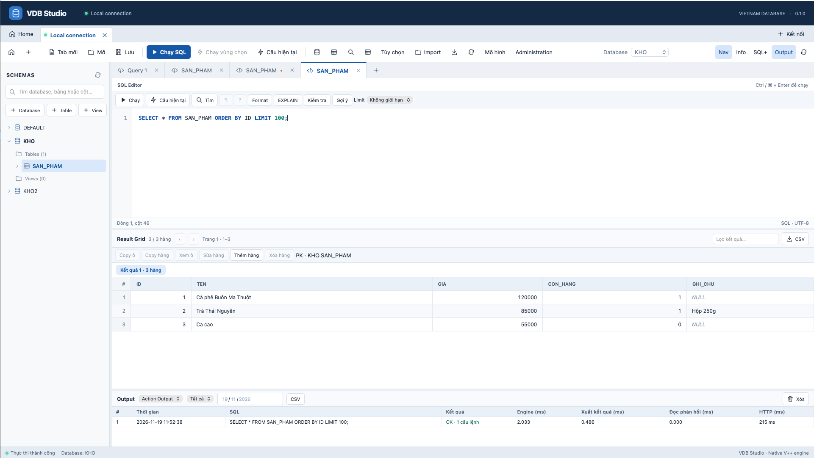

# VDB — Vietnam Database

[](https://github.com/winbiru/VDB/actions/workflows/ci.yml)
[](https://github.com/winbiru/VDB/releases)

**Hệ quản trị cơ sở dữ liệu quan hệ được xây dựng bằng ngôn ngữ lập trình Việt Nam [V++](https://github.com/winbiru/VXX).**

Từ câu lệnh SQL đầu tiên đến bộ tối ưu truy vấn và giao diện quản trị, VDB hướng tới một nền tảng dữ liệu độc lập do người Việt phát triển. Engine được viết bằng V++ (`.vi`), hoạt động độc lập với SQLite, MySQL và PostgreSQL.



*VDB Studio 0.1.0 — khám phá database, viết SQL, chỉnh sửa dữ liệu và theo dõi thời gian thực thi trong cùng một không gian làm việc.*

## ✨ Tính năng nổi bật

- **SQL quen thuộc:** tạo database, bảng, view; thêm, sửa, xóa và truy vấn dữ liệu với `JOIN`, `GROUP BY`, `HAVING`, `ORDER BY`, `DISTINCT` và `LIMIT`.
- **Tối ưu truy vấn:** chỉ mục B+ tree đơn và đa cột, thống kê dữ liệu, `ANALYZE`, `EXPLAIN`, lựa chọn thuật toán JOIN theo chi phí và sắp xếp thứ tự JOIN.
- **Toàn vẹn dữ liệu:** khóa chính, khóa ngoại, `UNIQUE`, `NOT NULL`, giao dịch theo batch với `BEGIN`, `COMMIT`, `ROLLBACK` và sao lưu, phục hồi catalog.
- **VDB Studio:** nhiều kết nối cục bộ, trình soạn thảo SQL có gợi ý, thiết kế bảng, khám phá schema, chỉnh sửa kết quả truy vấn được hỗ trợ và xuất CSV.
- **CLI độc lập:** thực thi SQL trực tiếp hoặc từ tệp, tích hợp vào script và mở Studio chỉ với một lệnh.

## 🚀 Bắt đầu

### Cài đặt

Tải gói và checksum tương ứng tại [GitHub Releases](https://github.com/winbiru/VDB/releases) khi được phát hành. Gói binary chứa engine và Studio, cài theo tài khoản người dùng và không cần cài V++.

| Nền tảng | Gói cài đặt | Studio |
| --- | --- | --- |
| macOS Apple Silicon | `vdb-macos-arm64.tar.gz` | Desktop native |
| Linux x86-64 | `vdb-linux-x64.tar.gz` | Trình duyệt |

Sau khi kiểm tra SHA-256 và giải nén gói, chạy `./install.sh` hoặc mở **VDB Setup.app** trên macOS. Gói macOS hiện ký ad-hoc, chưa notarize. Gói Linux đang chờ kiểm thử CI; macOS đã kiểm thử gói cục bộ và đang chờ nghiệm thu GUI.

```sh
export PATH="$HOME/.local/bin:$PATH"
vdb --version
vdb -e "SHOW DATABASES;"
vdb studio
```

Để cập nhật, đóng Studio rồi chạy `vdb update`.

### Build từ mã nguồn

Cài V++ native theo [hướng dẫn V++](https://github.com/winbiru/VXX#readme), sử dụng revision tương thích tại [VPP_REVISION](distribution/VPP_REVISION).

```sh
git clone https://github.com/winbiru/VDB.git
cd VDB
make VPP=/path/to/VPP
./vdb --version
./vdb --db data/demo.json -f examples/demo.sql
./vdb studio --db data/demo.json
```

## 💻 Thử một truy vấn

Ví dụ với catalog được tạo từ [demo.sql](examples/demo.sql), tìm các sản phẩm có giá từ 60.000 đồng trở lên.

```sql
USE kho;
SELECT ten, gia
FROM san_pham
WHERE gia >= 60000
ORDER BY gia DESC;
```

| TEN | GIA |
| --- | ---: |
| Cà phê Buôn Ma Thuột | 120000 |
| Trà Thái Nguyên | 85000 |

## 🛠️ Phát triển

```sh
make test
make test-studio-state
make test-studio
make benchmark-joins
```

VDB hiện ở giai đoạn MVP, chạy cục bộ với catalog JSON có phiên bản định dạng. Lộ trình tiếp theo gồm lưu trữ theo trang, buffer pool, WAL, phục hồi sau sự cố, MVCC và mô hình client/server có xác thực, phân quyền. Phiên bản hiện tại dành cho thử nghiệm và phát triển, chưa sẵn sàng cho production.

Theo dõi tiến độ tại [Checklist phát triển VDB](studio/CHECKLIST.md).
